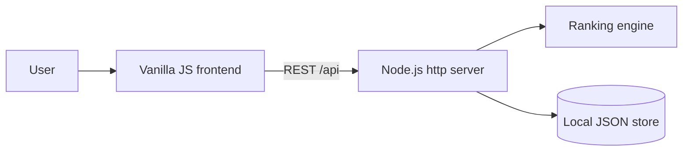

# Second Brain — Local Knowledge Base with Custom Search

> This repository provides a public overview of a privately maintained software project. The source code is not publicly available.

A local personal knowledge base for notes, transcripts, excerpts and decisions, with a self-written relevance-ranking search and a source-based question-answering view — built with plain Node.js and no external dependencies.

---

## Project Overview

| | |
|---|---|
| **Type** | Local web application |
| **Version** | 0.1.0 (prototype) |
| **Team** | Solo project |
| **Size** | ~1,100 lines, zero npm dependencies |

## Problem & Solution

**Problem:** Notes spread across many tools are hard to find again.

**Solution:** One local store with tags, URL import and a search engine written from scratch, so that results are explainable and no data leaves the machine.

## Key Features

- Store notes, transcripts, excerpts and decisions with tags
- Import content from URLs
- **Custom relevance ranking:** stop-word filtering, term frequency, exact-match boost, tag boost, recency boost
- Answer view that responds using only the saved sources (no LLM)
- Statistics overview

## Technology Stack

| Layer | Technologies |
|---|---|
| Server | Node.js 20+ built-in `http` module — no frameworks |
| Frontend | Vanilla JavaScript, HTML, CSS |
| Storage | Local JSON file |

## System Architecture

## My Role & Contributions

Sole developer:

- HTTP server and REST routing without frameworks, including safe static file serving
- Search and ranking algorithm
- Frontend UI

## Development Process

Built as a prototype to explore search and ranking fundamentals before adding embeddings or LLM-based answers.

See [DEVELOPMENT_LOG.md](DEVELOPMENT_LOG.md).

## Project Status

**Prototype (v0.1.0).** Planned next steps: semantic search with embeddings and LLM-generated answers.

## Screenshots

Not published yet.

## Technical Challenges & Solutions

| Challenge | Solution |
|---|---|
| Relevant results without a search library | Weighted scoring combining term frequency, exact matches, tags and recency |
| Serving static files securely without a framework | Path-traversal protection in the static file handler |

## Skills Demonstrated

`JavaScript` `Node.js` `HTTP fundamentals` `Information retrieval` `Ranking algorithms` `Vanilla frontend development`

---

### About the source code

The original repository is private. This showcase contains documentation only.
